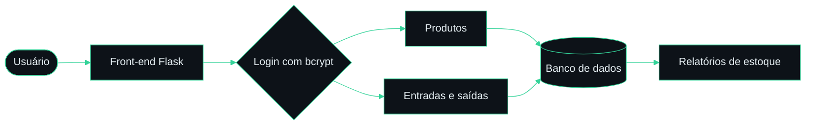

<p align="center">
  
</p>

<p align="center">
  <a href="https://github.com/gutubir">
    
  </a>
</p>

<p align="center">
  <a href="https://www.linkedin.com/in/rafaelgutubir/" target="_blank">
    
  </a>
  <a href="https://github.com/gutubir?tab=repositories">
    
  </a>
</p>

---

### 👨‍💻 Sobre mim

Comecei como **full stack** para entender o ciclo completo de uma aplicação, mas meu foco é o **back-end**. Estou construindo meu portfólio e aprendendo na prática.

```java
public class RafaelGutubir {

    String cargo         = "Desenvolvedor Full Stack";
    String foco          = "Back-end";

    String[] backEndEDados = {"Java", "Spring", "Python", "FastAPI", "Flask", "Node.js", "PostgreSQL", "MySQL"};
    String[] infraEDevOps  = {"Git", "GitHub", "GitHub Actions", "Docker"};
    String[] frontEnd      = {"HTML", "CSS", "JavaScript", "React", "Tailwind CSS"};

    String agora         = "Banco de dados, Spring Boot e APIs REST";
}
```

---

### 🛠️ Stack

**Back-end e dados**

<p align="left">
  
</p>

**Infra e DevOps**

<p align="left">
  
</p>

**Front-end**

<p align="left">
  
</p>

---

### 📌 Projetos em destaque

| Projeto | O que é | Stack |
|---|---|---|
| 🏋️ **Academia RGC Training (front-end)**<br>[Repo](https://github.com/gutubir/rgc_frontend) | Site da academia com chat integrado à API do chatbot de atendimento. | HTML · CSS · JavaScript |
| 🤖 **Chatbot da Academia RGC (API)**<br>[Repo](https://github.com/fabrodiego/api_academia_rgc_chatbot) | Backend do chatbot de atendimento da academia, do qual contribuo. | Java · Spring |
| 🎙️ **Helpdesk Recorder**<br>[Repo](https://github.com/gutubir/helpdesk-recorder) | Grava e transcreve ligações, com envio do áudio compactado para uma API. | Python · FastAPI · ffmpeg |
| 📦 **Gestão de Estoque (A3)**<br>[Repo](https://github.com/LucasRobertodaRosa/A3-GESTAO-DE-ESTOQUE) | Sistema de estoque com login, controle de entradas e saídas e relatórios. | Python · Flask · bcrypt |

---

### ☁️ Arquitetura: Gestão de Estoque



---

### 📊 Atividade no GitHub

<p align="center">
  
</p>

<p align="center">
  
</p>


